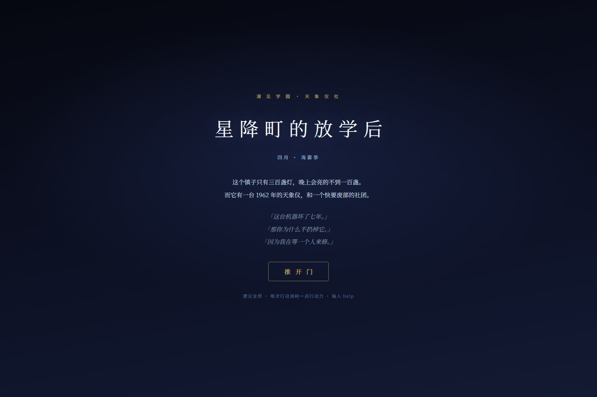
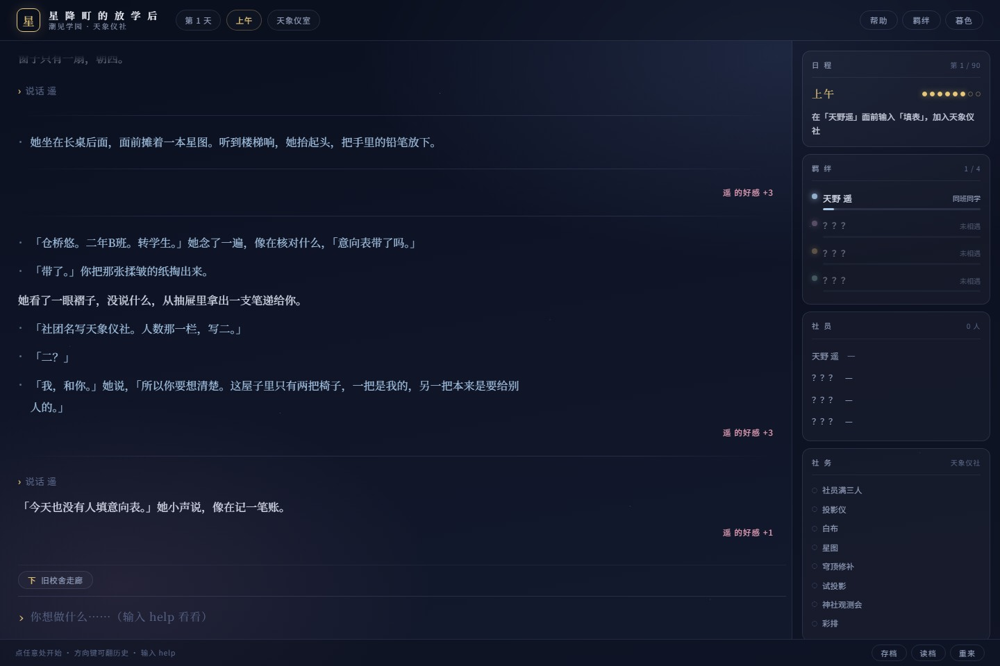
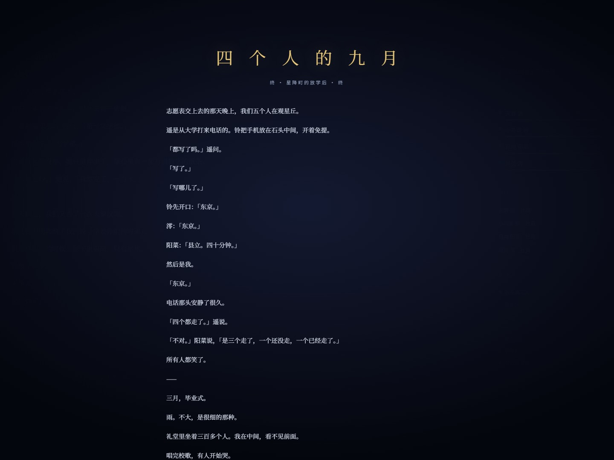

# 星降町的放学后

> 这个镇子只有三百盏灯，晚上会亮的不到一百盏。
> 而它有一台 1962 年的天象仪，和一个快要废部的社团。

一个日式轻小说风格的**文字冒险游戏（MUD）**。纯前端、零依赖、零构建，双击 `index.html` 即玩。


**[▶ 在线试玩](https://3cancanneed.github.io/hoshifuru-mud/)** — 不用装任何东西，浏览器打开就能玩。

---

<p align="center">
  
</p>

## 一句话

**四月，海边小镇，一个转学生被塞进了一张皱掉的社团意向表。**

天象仪社只有一个人，随时会废部。给你二十四天，招到人，把一台坏了七年的机器修好，在星见祭那天让它转起来。

然后，故事才过了四分之一。

## 玩法

不是点击式视觉小说，是**在命令行里过完一生中最长的那一年半**。

输入动作，回车。方向键翻历史，`Tab` 补全。

| 指令 | 说明 |
| --- | --- |
| `看` / `看 意向表` | 观察；细看某样东西常常有剧情 |
| `n` `s` `e` `w` `u` `d` | 走。也可以用 `北 南 东 西 上 下` |
| `说话` | 和同一个房间的人说话。**同一个人每天说一次有加成** |
| `填表` | 在天象仪馆填社团申请表 |
| `状态` | 日期、行动力、四个人的好感 |
| `日程` | 今天该干什么 |
| `睡` | 结束这一天 |
| `存档` / `读档` / `重来` | 浏览器本地存档 |

**时间就是行动力**：一天八点，说话和做事各耗一点，走路和「看」不耗。用完自动天黑。

<p align="center">
  
  <br>
  <sub>同一个人每天第一次说话好感 +3，之后闲聊 +1</sub>
</p>

## 一年半怎么过

| 天数 | 时候 | 会发生什么 |
| --- | --- | --- |
| 第 1–24 天 | 四月 — 七月 | 招人、修机器、星见祭 |
| 第 25–40 天 | 暑假 | 山上流星雨、盂兰盆、东京来的电话、第二场台风 |
| 第 41–60 天 | 九月 — 三月 | 文化祭、进路调查、修学旅行、冬夜观测、**遥的毕业式** |
| 第 61–80 天 | 四月 — 八月 | 教室里空了一个位置、大学来的电话、最后一次星见祭 |
| 第 81–90 天 | 九月 | 志愿表、交表前一天、观星丘 |

**两个分水岭**：

- **星见祭**（第 24 天）：机器没转起来，故事当天收场，你进不去后面的一年。
- **遥的毕业式**（第 60 天）：她走了，但故事不会在这里结束——四月，教室重新排座位，第三排靠窗那个位置换了人。

走完 90 天，才是终章。

## 四个人

|  | 她 | 你会在哪儿遇见 |
| --- | --- | --- |
| 🌙 | **天野遥** — 社长。三年级。怕黑，也怕毕业。 | 旧校舍三楼 · 天象仪馆 |
| 📖 | **小鸟游铃** — 图书委员。在写一个关于你的故事，写不出结局。 | 图书室 |
| ☀️ | **日向阳菜** — 田径部。跑得比谁都快，膝盖比谁都疼。 | 操场 |
| 🌊 | **月见澪** — 长期缺席。替姐姐完成一件没做完的事。 | 保健室 |

每个人有**十七段**羁绊剧情，按好感度依次解锁：从「同班同学」到「不想失去的人」。同一个人每天第一次说话好感 +3，之后闲聊 +1。

## 十九个结局

**星见祭没办成**（第 24 天当场收场）：

- **九月** — 什么都没修好
- **星降町** — 四个人都走进了那间屋子
- 以及四个人各自的第一个夏天

**遥毕业了**（第 60 天，故事继续）：

- **第二个星见祭**、**看不见的人**、**结局**、**一千二百米**、**三十七道之后**、**潮见町的春天**
- 这六段是「三月那天你们是什么样子」，写在毕业式当晚，然后故事进入第三部

**走完 90 天**（志愿表交上去之后）：

- **四个人的九月**（真结局：四个人都还愿意爬上山）
- **两百一十七步**（天野遥：她数过的那条路）
- **第二本书**（小鸟游铃：她终于写完了那一章）
- **一年零十四秒**（日向阳菜：她跑完了，只是慢一点）
- **二十一页**（月见澪：她终于不只是替别人活着）
- **回东京**（谁也没走近，你搬走了）

<p align="center">
  
  <br>
  <sub>真结局「四个人的九月」——志愿表交上去之后的那个晚上</sub>
</p>

## 内容

- **21 个地点**：校门、中庭、玄关、二楼走廊、旧校舍、天象仪馆、图书室、操场、保健室、天台、物理准备室、空教室、小卖部、商店街、车站、神社、星见祭会场、防波堤、观星丘、家、便利商店
- **90 天**，十幕，从四月海雾季到次年九月志愿季
- **70 段主线** + **68 段羁绊剧情** + **36 段日常小事件** = 174 段
- 四个可攻略角色，各自有一年半的秘密
- 约 **4.2 万字**
- 存档走 `localStorage`，关掉浏览器也在

## 文件

```
星降町/
├── index.html          结构（幕布、日志、侧栏、底栏）
├── css/style.css       夜景配色，三套主题
├── screenshots/        截图
├── LICENSE             MIT
└── js/
    ├── data/
    │   ├── world.js      标题、序章、章节、称号、天数
    │   ├── rooms.js      21 个地点
    │   ├── cast.js       人物与对白
    │   ├── story.js      主线（第一学期）
    │   ├── events.js     羁绊事件（第一阶段）
    │   ├── tale.js       七个「第一部」结局
    │   ├── extra.js      补充：后期主线、后段羁绊、日常
    │   ├── extra2.js     补充：中期支线、日常
    │   ├── extra3.js     补充：前中段羁绊
    │   ├── semester2.js  第二部主线：暑假 / 第二学期 / 终章
    │   ├── extra4.js     第二学期羁绊（每人四段）
    │   ├── extra5.js     第二学期日常
    │   ├── tale2.js      六个「遥毕业那天」的结局
    │   ├── after.js      第三部主线：遥走后的那半年
    │   ├── extra6.js     第三部羁绊（每人三段）
    │   └── tale3.js      六个终章结局
    ├── engine.js       解析命令、推进时间、判定结局
    └── main.js         渲染、按键、存档、结局层
```

## 技术笔记

- **不用 ES module**：`file://` 下 `type="module"` 会被 CORS 拦死，普通 `<script src>` 才能双击打开。
- **数据与引擎分离**：想加一个角色、一段剧情、一个地点，只改 `js/data/` 里的文件，引擎不用动。第二部就是这么加的——`semester2.js` 用 `DATA.story.concat()` 追加，引擎一行没改。
- **时间就是状态**：没有定时器，`S.day` 与 `S.ap` 就是全部时间。省得处理后台标签页的计时漂移。
- **关系是可积累的**：好感不是开关，是每天说一句话累积起来的数字。
- **中段判定**：`spend()` 在 `S.day === actBreak` 时检查主线三要件，不满足当场收场。这样「办砸了」和「办成了」共用同一套引擎。

## 姊妹作

同引擎还有两个版本：中式志怪 **《归墟 · 拾遗人纪事》**、西幻循环 **《十三响》**。

## 许可

MIT。随便玩，随便改。
